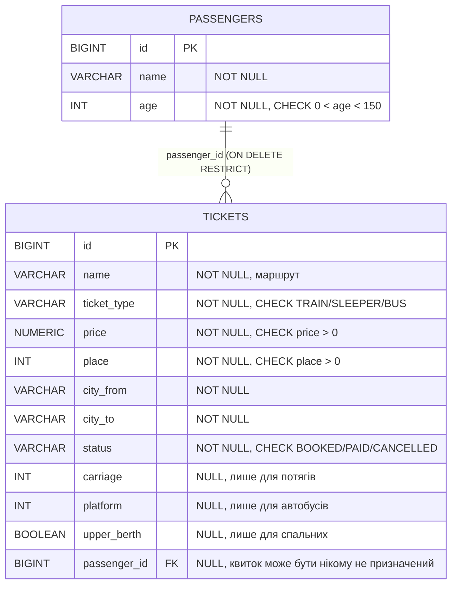
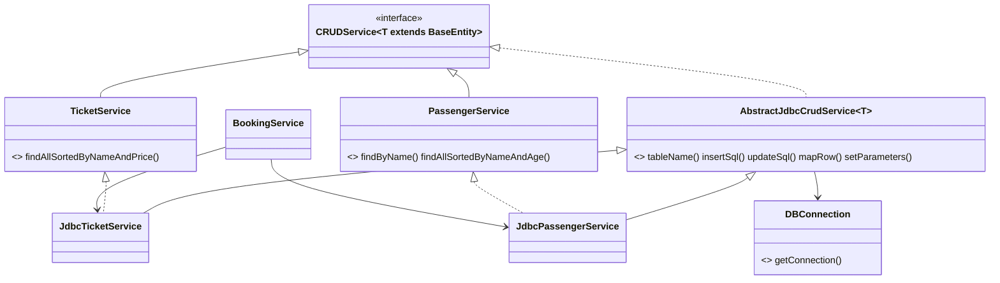

# Лабораторна робота №10. Maven і робота з реляційною БД через JDBC (високий рівень)

**Предметна область:** квитки на транспорт і пасажири (продовження ЛР №6–9).
**Гілка:** `lr10/maven-jdbc`
**СУБД:** H2 у файловому режимі (`./data/tickets.mv.db`). Окремо нічого встановлювати не потрібно.

У ЛР №7 сервіси зберігали дані в `LinkedHashMap`. Тепер ті самі інтерфейси (`CRUDService<T>`, `TicketService`) реалізовані поверх БД. Секції 1–7 в `Main` (демо з ЛР №7) викликають сервіс тільки через інтерфейс, тож код, який ним користується, не змінився: змінилось лише місце створення (`new JdbcTicketService()` замість `new InMemoryTicketService()`).

## Запуск з нуля
Потрібні JDK 21 і Maven 3.9+.
1. БД створювати вручну не треба: H2 створює файл `data/tickets.mv.db` при першому підключенні, а схему (`init.sql`) програма виконує сама при старті.
2. Параметри підключення лежать у `src/main/resources/application.properties` (`db.url`, `db.user`, `db.password`, `db.pool.size`). Їх можна перевизначити змінними середовища `DB_URL`, `DB_USER`, `DB_PASSWORD`. Для PostgreSQL/MySQL достатньо змінити URL і замінити залежність драйвера в `pom.xml`.
3. Запуск:
```bash
mvn compile
mvn exec:java
```
Кирилицю у виводі забезпечує `.mvn/jvm.config` (`-Dstdout.encoding=UTF-8`). У PowerShell перед запуском виконайте `chcp 65001`.

## Схема БД

Зв'язок «один до багатьох»: один пасажир має багато квитків.

### Рішення щодо проєктування
- **Первинний ключ.** `id BIGINT` без автоінкременту. Це сурогатний ключ, але значення задає код: у `BaseEntity` поле `id` незмінне й задається в конструкторі (для квитка це номер квитка). Тому `save` сам вирішує між `INSERT` і `UPDATE`, а `RETURN_GENERATED_KEYS` не потрібен.
- **Ієрархія `Ticket` в одній таблиці.** `TrainTicket`, `SleeperTrainTicket` і `BusTicket` лежать у `tickets`, тип визначає стовпець `ticket_type`, а специфічні поля (`carriage`, `platform`, `upper_berth`) допускають `NULL`. Так простіше, ніж три таблиці з JOIN. Ціна: у частини рядків є порожні стовпці. `mapRow` по `ticket_type` будує потрібний підклас.
- **`NUMERIC(10,2)` для ціни.** `FLOAT/DOUBLE` зберігають двійкове наближення (0.1 + 0.2 ≠ 0.3), для грошей це неприйнятно. У Java це `BigDecimal` (`ps.setBigDecimal`, `rs.getBigDecimal`). Сутність `Ticket` з ЛР №6 лишилась на `double`, тож на межі стоїть конвертація `BigDecimal.valueOf(price)` / `.doubleValue()`.
- **`UNIQUE (name, place)`.** Те саме місце на тому самому маршруті не можна продати двічі.
- **`CHECK`** на вік, ціну, місце, тип і статус дублюють валідацію конструкторів: БД не пустить некоректні дані, навіть якщо їх запише хтось поза Java-кодом.
- **Індекси.** Автоматично є індекси на PK і `UNIQUE`. Додано `idx_tickets_passenger (passenger_id)`: БД не створює індекс на зовнішній ключ сама, а запити `findByPassengerId` і перевірка `ON DELETE` без нього скануватимуть усю таблицю. `idx_tickets_name_price (name, price)` відповідає `ORDER BY name, price`. Індекси прискорюють читання, але сповільнюють `INSERT/UPDATE/DELETE`, бо їх теж треба оновлювати.

### Чому `ON DELETE RESTRICT`
Квиток це фінансовий документ. Варіанти:
- `CASCADE` разом з видаленням пасажира мовчки видалив би всі його квитки, тобто історію продажів. Одна помилкова `delete` знищує дані.
- `SET NULL` залишив би квитки без власника: вони зберігаються, але вже не зрозуміло, кому належать, і місце виглядає «вільним», хоча було продане.
- `RESTRICT` змушує спершу свідомо скасувати чи видалити квитки, а потім пасажира. У `Main` (секція 8) спроба видалити пасажира з квитками дає `Referential integrity constraint violation`.

## Архітектура

- Код розкладено по пакетах: `ua.edu.tickets` (модель, інтерфейси, реалізація в пам'яті з ЛР №7, `Main`) і `ua.edu.tickets.jdbc` (усе, що знає про SQL). SQL лежить лише в `jdbc`-пакеті й у `init.sql`.
- **Template Method.** Каркас в `AbstractJdbcCrudService`: `findById`, `save`, `delete`, `findAll`, `findPage`, `count`, `insertAllBatch`, а також `query(...)`, що відкриває й закриває ресурси та викликає `mapRow` для кожного рядка. Підкласи перекривають `tableName`, `insertSql`, `updateSql`, `mapRow`, `setParameters`. Друга сутність (`Passenger`) і перша (`Ticket`) реалізовані через цей клас. Домовленість: у `insertSql`/`updateSql` `id` стоїть останнім параметром, тому один `setParameters` обслуговує обидва запити.
- **`save`** спершу виконує `UPDATE ... WHERE id = ?`. Якщо змінено 0 рядків, виконує `INSERT`. Так само, як `Map.put` у ЛР №7: додає або оновлює.
- **`findById`** кидає `EntityNotFoundException`, якщо рядка немає.
- **`SQLException`** обгортається в неперевірений `DataAccessException`, бо сигнатури інтерфейсів з ЛР №7 не мають `throws SQLException`, а клієнтський код не має залежати від JDBC.
- **Сортування** робить БД: `ORDER BY name, id` та `ORDER BY name, price, id`. Додатковий `id` робить порядок детермінованим для однакових назв. Без `ORDER BY` порядок рядків не гарантований. Українське впорядкування літер (Є, І, Ї, Ґ) забезпечує `SET COLLATION UKRAINIAN` у `init.sql` (специфічно для H2); без нього H2 порівнює за кодами Unicode й, наприклад, ставить «Ґ» після «Я».
- **Поле сортування не можна параметризувати** (`ORDER BY ?` підставить літерал, а не ім'я стовпця). Тому кожен варіант сортування це окремий метод з фіксованим SQL.

## Транзакція (рівень 2)
`BookingService.registerPassengerWithTickets` додає пасажира й усі його квитки: `setAutoCommit(false)`, `save` пасажира й квитків на одному `Connection`, `commit()`; при будь-якому винятку `rollback()` у `catch`, у `finally` повертається `autoCommit(true)`.

Демо (секція 9 у `Main`): другий квиток займає вже продане місце, порушується `UQ_TICKET_SEAT`. Результат:
```
COMMIT: пасажир №10 і його квитки: 2 шт.
ROLLBACK: Unique index or primary key violation (PUBLIC.UQ_TICKET_SEAT_INDEX_D)
Пасажирів до: 4, після: 4 (пасажир №11 не збережений)
Квиток №203, вставлений до помилки, теж відкотився: Сутність з id=203 не знайдено
```
Пасажир №11 і квиток №203 були вже вставлені на момент помилки, але відкат прибрав обидва: це атомарність (A з ACID).

## SQL-ін'єкція
«Поганий» метод **не** лишився в коді, тут лише приклад (запуск проти тих самих даних):
```java
// НЕБЕЗПЕЧНО: значення склеюється з SQL
String sql = "SELECT id, name FROM passengers WHERE name = '" + name + "'";
try (Statement st = conn.createStatement(); ResultSet rs = st.executeQuery(sql)) { ... }
```
```
name = "Петренко Олена"
SQL: SELECT id, name FROM passengers WHERE name = 'Петренко Олена'
  -> 1 Петренко Олена                       (рядків: 1)

name = "x' OR '1'='1"
SQL: SELECT id, name FROM passengers WHERE name = 'x' OR '1'='1'
  -> 1 Петренко Олена
  -> 2 Іваненко Андрій
  -> 3 Єрмоленко Ірина                      (рядків: 3, повернулась уся таблиця)
```
Лапка в даних закрила рядковий літерал, а решта потрапила в запит як SQL-код. «Добрий» метод `JdbcPassengerService.findByName` (`WHERE name = ?` + `ps.setString`) на тому самому рядку повертає **0 рядків** (секція 10 у `Main`): запит розбирається до підстановки значення, тож значення завжди лишається даними, а не кодом.

## Singleton і одне спільне Connection (рівень 3)
Якби `DBConnection` тримав одне `Connection` на весь застосунок:
- **Багатопотоковість.** `Connection` не призначений для одночасного використання: потоки перемішують запити, `ResultSet` одного закривається при виконанні наступного `Statement` на тому ж з'єднанні, а їх треба серіалізувати вручну (`synchronized`), що перетворює БД на вузьке місце.
- **Транзакції різних клієнтів.** Транзакція належить з'єднанню. Якщо один потік зробив `setAutoCommit(false)`, чужі `save` на тому самому з'єднанні потраплять у його транзакцію: `commit` одного закріпить зміни іншого, а `rollback` скасує чужі.
- **Розрив з'єднання.** БД перезапустилась, мережа обірвалась або з'єднання закрилось за таймаутом: єдине `Connection` стає непридатним для всіх, і без перевірки та перепідключення програма «лежить» до перезапуску.

**Реалізовано варіант 1:** потокобезпечний Singleton, що віддає з'єднання з пулу **HikariCP**. `DBConnection` тримає `HikariDataSource`, кожен виклик `getConnection()` дає окреме з'єднання, а `close()` у try-with-resources повертає його в пул (фізично не закриває). Екземпляр створюється ліниво через holder-клас: JVM гарантує, що клас `Holder` ініціалізується один раз і потокобезпечно, без `synchronized` у кожному виклику. Пул відкриває з'єднання наперед (відкриття нового коштує дорого: мережа, автентифікація), перевіряє їх працездатність і замінює обірвані. Розмір пулу задається `db.pool.size`.

Недоліки Singleton, що лишаються: прихована залежність (сервіси самі викликають `DBConnection.getInstance()`, а не отримують його в конструкторі), глобальний стан і складніше тестування. Для навчального проєкту це прийнятно; для тестів кращий варіант з передачею `DataSource` через конструктор (dependency injection).

## Пакетна вставка (рівень 3)
`insertAllBatch(list, 1000)`: один `PreparedStatement`, `addBatch()` для кожної сутності, `executeBatch()` кожні 1000 рядків, один `commit` наприкінці. Базовий варіант: цикл із `insert(entity)`, де кожен запис отримує своє з'єднання з пулу, окремий запит і окремий `commit`.

Вимірювання (секція 11 в `Main`, H2 file, 5000 пасажирів у кожному варіанті, два запуски поспіль):

| Спосіб | Запуск 1 | Запуск 2 |
|---|---|---|
| По одному запису | 443 мс | 437 мс |
| `addBatch`/`executeBatch` | 71 мс | 73 мс |

Пакетна вставка швидша приблизно в 6 разів. Причини: один commit замість 5000 (кожен commit це скидання журналу на диск), менше звернень до драйвера та БД, запит розбирається один раз. Абсолютні числа залежать від машини; для мережевої СУБД різниця буде ще більшою, бо кожен окремий запит додає мережеву затримку.

## Пагінація (рівень 3)
`findPage(page, size)`: `SELECT * FROM t ORDER BY id LIMIT ? OFFSET ?` (`OFFSET = page * size`, сторінки з 0). `count()` потрібен, щоб знати кількість сторінок. Приклад з демо (10 000 рядків): сторінка 1999 розміру 5 це `id 9996..10000`.

**Чому `findAll()` без обмежень небезпечний для великої таблиці:** усі рядки перетворюються на Java-об'єкти й одночасно лежать у пам'яті (`OutOfMemoryError` на мільйонах рядків); довго тримається з'єднання з пулу; великий обсяг даних передається мережею; користувачеві зазвичай потрібна лише сторінка.

**Обмеження `LIMIT/OFFSET`:** БД усе одно мусить пройти й відкинути `OFFSET` рядків, тому глибокі сторінки повільні. Якщо між запитами рядки додаються чи видаляються, сторінки зсуваються (дублікати або пропуски). Для дуже великих таблиць краща keyset-пагінація: `WHERE id > ? ORDER BY id LIMIT ?`. `ORDER BY` обов'язковий: без нього порядок рядків між запитами не гарантований.

## Структура проєкту
```
pom.xml
.mvn/jvm.config
src/main/java/ua/edu/tickets/        модель, інтерфейси, реалізація в пам'яті (ЛР №7), Main
src/main/java/ua/edu/tickets/jdbc/   DBConnection, SchemaInitializer, AbstractJdbcCrudService,
                                     JdbcTicketService, JdbcPassengerService, BookingService
src/main/resources/init.sql          ідемпотентна схема
src/main/resources/application.properties
```

## Зміни порівняно з ЛР №7
- Файли перенесено в пакет `ua.edu.tickets` (стандартна структура Maven).
- У `Ticket` додано `getPlace()`, `getCityOfDeparture()`, `getCityOfArrival()` (потрібні, щоб зберегти їх у стовпці) і необов'язкове поле `passengerId` із getter/setter для зовнішнього ключа.
- Додано інтерфейс `PassengerService`. `InMemoryCrudService` лишився й працює як раніше.

## Залежності (`mvn dependency:tree`)
| Залежність | scope | Навіщо |
|---|---|---|
| `com.zaxxer:HikariCP:5.1.0` | compile | пул з'єднань, код імпортує `HikariDataSource` |
| `com.h2database:h2:2.3.232` | runtime | JDBC-драйвер: код працює через `java.sql.*`, тож для компіляції драйвер не потрібен |
| `org.slf4j:slf4j-simple:2.0.16` | runtime | логування для HikariCP |
| `org.slf4j:slf4j-api` | compile (транзитивно від HikariCP) | приклад транзитивної залежності |
