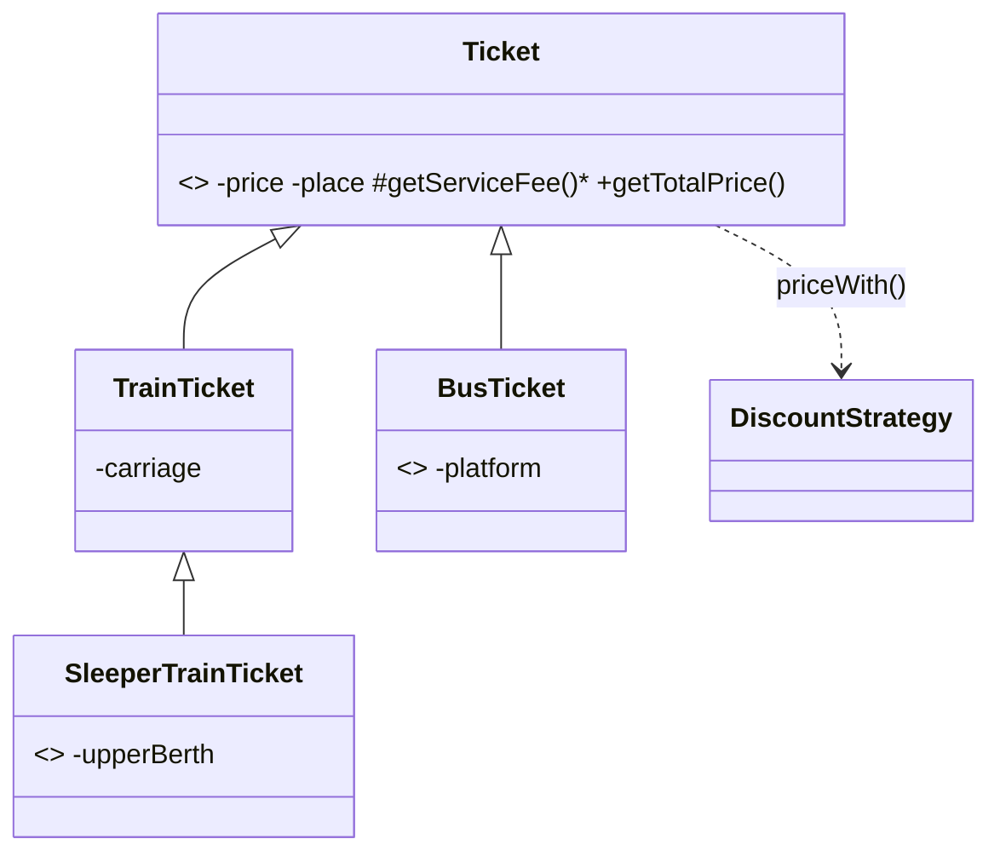

# Лабораторна робота №6. Ієрархія класів (рівень 3)

**Предметна область:** квитки зі знижками (продовження ЛР №5).
**Гілка:** `lr6/tickets-inheritance`

## Запуск
Потрібен JDK 21.
```bash
mkdir out
javac -encoding UTF-8 -d out *.java
java -Dfile.encoding=UTF-8 -cp out Main
```

## Що зроблено
Квиток із ЛР №5 став ієрархією за видом транспорту. Знижки, фабрика й observer з ЛР №5 лишились без змін.



**is-a:** автобусний і потяжний квиток є різновидом квитка; спальний є різновидом потяжного. Поля `private`, у підкласах тільки специфічні.

## Рівень 1
`super(...)` у конструкторах, `@Override` для `getServiceFee()` і `toString()` (через `super.toString()`), поліморфний цикл по `List<Ticket>` (секція 2).

## Рівень 2
- **Абстрактний** `Ticket`, бо квиток без виду транспорту не існує. **Абстрактний метод** `getServiceFee()`: у кожного виду свій збір, спільної реалізації немає.
- **Три рівні** і порядок конструкторів (див. секцію 1): `Ticket` -> `TrainTicket` -> `SleeperTrainTicket`. Базова частина об'єкта має бути створена перед підкласом.
- **`this(...)`:** конструктори без вагона/платформи делегують повному.
- **`final`:** `getTotalPrice()` (формула однакова для всіх), класи `BusTicket` і `SleeperTrainTicket` (підкласів не буде).
- **instanceof:** `if (t instanceof TrainTicket tr)` (секція 3). Статичний тип змінної `t` це `Ticket`, він визначає, які методи видно компілятору. Динамічний тип це реальний клас об'єкта, за ним вибирається версія `getServiceFee()` у рантаймі.

## Рівень 3
- **equals/hashCode:** у `Ticket` через `getClass()`, підкласи додають свої поля через `super.equals(obj) && ...`. `train.equals(sleeper)` і `sleeper.equals(train)` обидва `false`, симетрія є (секція 5). З `instanceof` було б `true` в один бік і `false` в інший, бо підклас порівнює ще й полицю.
- **Композиція:** знижка. `StudentTicket extends Ticket` було б хибне «is-a»: студент це властивість пасажира, а не різновид квитка. Зламалося б: вибух класів (`StudentBusTicket`, `PensionerTrainTicket`...), знижку не змінити в об'єкта в рантаймі, а успадковувати можна лише один клас. Тому квиток **має** знижку: `priceWith(DiscountStrategy)`.
- **sealed:** `Ticket` `permits TrainTicket, BusTicket`, `TrainTicket` `permits SleeperTrainTicket`. Компілятор знає всі підтипи, тому `switch` в `Main.describe` без `default` перевіряється на повноту. Додав новий підклас без `case` і код не скомпілюється.
