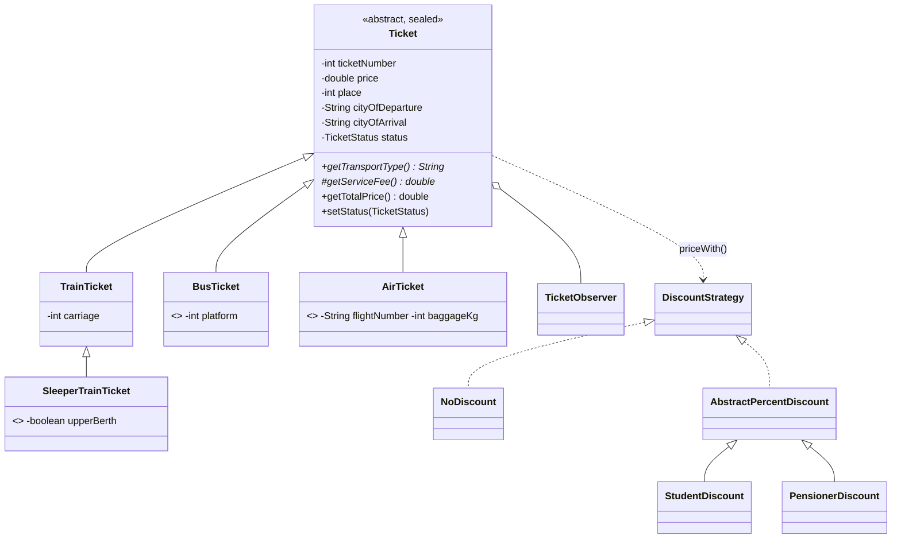

# Лабораторна робота №6. Ієрархія класів на основі наслідування (рівень 3)

**Предметна область:** квитки зі знижками (рефакторинг коду ЛР №5).
**Гілка:** `lr6/tickets-inheritance`

## Запуск
Потрібен JDK 21 (sealed + switch з pattern matching).
```bash
mkdir out
javac -encoding UTF-8 -d out *.java
java -Dfile.encoding=UTF-8 -cp out Main
```

## Що змінилось відносно ЛР №5
Раніше `Ticket` був одним класом для всіх. Тепер квиток має вид транспорту, а в ньому свої поля й правила ціни.

| Клас | Що додає |
|---|---|
| `Ticket` (abstract, sealed) | спільні поля, статус, спостерігачі, `equals/hashCode`, `getTotalPrice()` |
| `TrainTicket` | `carriage` (вагон), збір 15 грн |
| `SleeperTrainTicket` | `upperBerth`, збір +40 грн (білизна) |
| `BusTicket` | `platform`, збір 5 грн |
| `AirTicket` | `flightNumber`, `baggageKg`, збір 100 грн + 10 грн за кг понад 20 |

## Діаграма класів


## Перевірка «is-a»
- Потяжний / автобусний / авіаквиток **є різновидом** квитка.
- Спальний квиток **є різновидом** потяжного.

## Рівень 1
- Спільні поля, конструктор і методи в `Ticket`; у підкласах лише специфічні поля. Усі поля `private`, `protected` лише конструктор і `getServiceFee()` (їх викликають підкласи).
- Підкласи викликають `super(...)`.
- `@Override`: `getTransportType()`, `getServiceFee()`, `toString()` (через `super.toString()` + свої поля), `equals`, `hashCode`.
- Поліморфізм: `List<Ticket>` з об'єктами різних підкласів, у циклі викликаються `toString()` і `getTotalPrice()` (секція 2 в `Main`).

## Рівень 2
- **Абстрактний клас.** `Ticket` абстрактний, бо квиток «взагалі», без виду транспорту, не існує. **Абстрактний метод** `getServiceFee()`: у базі немає змістовної реалізації, а кожен вид транспорту має свою формулу збору. Звичайний метод з «заглушкою» 0 дозволив би забути його перевизначити.
- **Три рівні:** `Ticket -> TrainTicket -> SleeperTrainTicket`. Порядок конструкторів (див. вивід): `Ticket` -> `TrainTicket` -> `SleeperTrainTicket`. Спочатку виконується конструктор базового класу (через `super(...)`), бо підклас не може існувати без ініціалізованої «базової частини», потім тіло конструктора підкласу.
- **`this(...)`:** `TrainTicket(..., to)` делегує у `TrainTicket(..., to, 1)`; так само в `BusTicket` і `AirTicket`. Код ініціалізації не дублюється.
- **`final`:** `getTotalPrice()` у `Ticket` final: формула «ціна + збір» єдина, підкласи змінюють лише збір. Класи `SleeperTrainTicket`, `BusTicket`, `AirTicket` теж final: подальших підкласів не планується.
- **`instanceof` з pattern matching:** `if (t instanceof TrainTicket tr) ...` (секція 3). **Статичний тип** змінної `t` це `Ticket`, за ним компілятор визначає, які методи можна викликати (тому `getCarriage()` напряму недоступний). **Динамічний тип** це реальний клас об'єкта, за ним у рантаймі вибирається версія перевизначеного методу (`getServiceFee()`).

## Рівень 3
### equals / hashCode
- `Ticket.equals` використовує `getClass()`, підкласи додають свої поля через `super.equals(obj) && ...`.
- Результат: `train.equals(sleeper)` і `sleeper.equals(train)` обидва `false`, симетрія збережена (секція 5).
- Якби в базі був `instanceof`, то `train.equals(sleeper)` могло б бути `true` (бо `sleeper instanceof TrainTicket`), а `sleeper.equals(train)` `false` (бо підклас порівнює ще й полицю): симетрія зламана.
- Вибір `getClass()`: рівність у межах одного конкретного виду квитка, різні види ніколи не рівні. Ціна: підклас не можна підставити там, де очікується рівність з базовим (формально це обмеження LSP, але для квитків різних видів воно бажане).
- `hashCode` узгоджений з `equals`: включає ті самі поля.

### Композиція замість наслідування
Знижки. Хибний варіант: `StudentTicket extends Ticket`, `PensionerTicket extends Ticket`. Це «is-a» хибне: студент це властивість **пасажира/умови покупки**, а не різновид квитка. Що зламалося б:
1. Комбінація «вид транспорту × тип знижки» дала б вибух класів (`StudentBusTicket`, `PensionerAirTicket`...).
2. Знижка не змінюється в рантаймі в об'єкта, тип якого вже обраний наслідуванням.
3. Одне успадкування в Java: `StudentTicket` не міг би одночасно бути і `BusTicket`.

Тому знижка це окремий об'єкт: `Ticket.priceWith(DiscountStrategy)`. Аналогічно статус і спостерігачі: квиток **має** `TicketStatus` і список `TicketObserver`.

### sealed + switch
`Ticket` оголошено `sealed ... permits TrainTicket, BusTicket, AirTicket`, `TrainTicket` `sealed permits SleeperTrainTicket`. У `Main.describe` `switch` по `Ticket` без `default`. **Гарантія sealed:** компілятор знає повний перелік підтипів, тож перевіряє виняткову повноту `switch`. Якщо додати новий підклас у `permits`, але не додати `case`, код не скомпілюється. Порядок `case`: `SleeperTrainTicket` перед `TrainTicket` (більш конкретний тип має йти першим).

## Як додати новий вид квитка
Новий клас (наприклад, `FerryTicket`), додати в `permits` у `Ticket`, реалізувати `getTransportType()` і `getServiceFee()`. Компілятор підкаже, де треба додати `case` у `switch`. Решта класів (`DiscountFactory`, спостерігачі, `Main` окрім `switch`) без змін.
