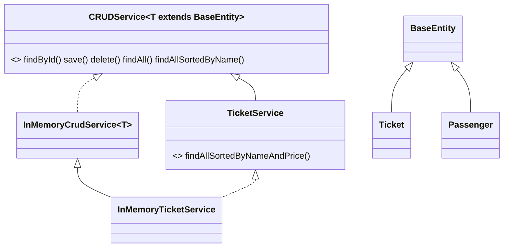

# Лабораторна робота №7-9. Типізований CRUD-сервіс (середній рівень)

**Предметна область:** квитки на транспорт (продовження ЛР №6) і пасажири.
**Гілка:** `lr7/crud-service`

## Запуск
Потрібен JDK 21.
```bash
mkdir out
javac -encoding UTF-8 -d out *.java
java -Dfile.encoding=UTF-8 -Dstdout.encoding=UTF-8 -cp out Main
```

## Сутності
- `BaseEntity` (абстрактний): `long id` (final, не змінюється) і `String name` (не null, не порожнє).
- `Ticket extends BaseEntity` (ієрархія з ЛР №6 збережена): `id` = номер квитка, `name` = маршрут («Чернівці → Київ»). У підкласах лишились тільки специфічні поля (вагон, платформа, полиця).
- `Passenger extends BaseEntity`: `name` = ПІБ, додаткове поле `age`.

У базовий клас винесено лише те, що потрібно сервісу для будь-якої сутності (ідентифікація й назва). Ціна, місце, вік є у конкретних сутностей, бо в «пасажира» немає ціни.

### Зміни порівняно з ЛР №6
- `ticketNumber` став `id` з `BaseEntity`; `getTicketNumber()` повертає `(int) getId()`.
- Перевизначення `equals/hashCode` у `Ticket`, `TrainTicket`, `SleeperTrainTicket`, `BusTicket` **видалені**: методичка вимагає рівність за `id` у `BaseEntity`, а старі версії порівнювали всі поля, тож суперечили б їй.
- Прибрано діагностичні `println` з конструкторів, щоб не шуміли у виводі демо.

## Структура


## Рівень 1

**Чому `EntityNotFoundException` перевірений (`extends Exception`).** Звернення до неіснуючого id у цьому сервісі очікувана ситуація (користувач ввів хибний номер), і викликаючий код може на неї відреагувати (повторити запит, показати повідомлення). Компілятор змушує це обробити. Ціна: `throws` у сигнатурі `findById` і `try/catch` у викликаючому коді. Виняток із ЛР №6 (`TicketException`) неперевірений, бо описує помилки валідації, тобто баги в коді, що викликає.

**Навіщо `T extends BaseEntity`.** Без обмеження `T` для компілятора це `Object`. Всередині `InMemoryCrudService.save` не можна було б викликати `entity.getId()`, щоб отримати ключ мапи, а `findAllSortedByName()` не міг би звернутись до `getName()`. Довелося б приводити типи вручну.

**Один клас для обох сутностей.** `InMemoryCrudService<Passenger>` у `Main` (секція 6) і `InMemoryTicketService`, що успадковує `InMemoryCrudService<Ticket>`, працюють з тим самим кодом.

**Чому `findById` кидає виняток, а `delete` повертає `boolean`.** `findById` мусить повернути сутність, а повернути «нічого» можна лише через `null`, який змушує кожного викликача пам'ятати перевірку. `delete` нічого не повертає по суті, тому `false` («не було що видаляти») природний результат і не помилка.

**`save`.** Нову сутність від наявної відрізняє наявність ключа `id` у мапі: `Map.put` додає або замінює. Повторний виклик з тим самим id оновлює запис, кількість не збільшується. `save(null)` кидає `NullPointerException` через `Objects.requireNonNull`.

## Рівень 2

### Вибір колекції для сховища
Обрано `LinkedHashMap<Long, T>` (ключ id).

| Колекція | findById | save (додати/оновити) | delete | Відсортований список | Порядок обходу |
|---|---|---|---|---|---|
| `ArrayList<T>` | O(n), лінійний пошук | O(n) (треба шукати, чи є id), додавання в кінець O(1) | O(n) | копія + sort, O(n log n) | порядок додавання |
| `HashMap<Long, T>` | O(1) в середньому | O(1) | O(1) | копія + sort, O(n log n) | не гарантований |
| `LinkedHashMap<Long, T>` | O(1) | O(1) | O(1) | копія + sort, O(n log n) | порядок додавання, повторний `put` існуючого ключа **не** змінює позицію |
| `TreeMap<Long, T>` | O(log n) | O(log n) | O(log n) | сортує лише за ключем (id), за іменем все одно копія + sort | за зростанням id |

Головні операції сервісу `findById`, `save`, `delete`, тож потрібен O(1), і це дають `HashMap` та `LinkedHashMap`. З них обрано `LinkedHashMap`, бо `findAll()` і вивід «до сортування» мають стабільний порядок додавання. `TreeMap` сортує за id, а сортування за іменем усе одно потребує копії. `TreeSet` з компаратором за іменем як сховище не можна: два елементи з однаковою назвою компаратор вважає рівними, і другий **мовчки не додався б**.

Якби головною операцією був відсортований вивід, доцільніший `TreeMap` або `TreeSet` з компаратором, що враховує id для розрізнення. Для мільйонів записів `HashMap` лишається прийнятним: пошук O(1), а сортування O(n log n) робиться на вимогу.

### Сортування
- **`findAllSortedByName()`** і **`findAllSortedByNameAndPrice()`** використовують `Comparator`, а не `Comparable`. Причини: (1) `Comparable` дає один «природний» порядок, а `Ticket` уже має його за ціною (з ЛР №6); (2) `findAllSortedByName` живе в `CRUDService<T>` і має працювати для кожного `T`, тож порівняння, написане один раз за `BaseEntity::getName`, не вимагає змін у сутностях; (3) з `Comparable` другий порядок довелося б усе одно робити компаратором.
- Імена порівнюються через `Collator` для `uk` (`NameOrder.UKRAINIAN`), бо `String.compareTo` ставить «Є», «І», «Ї», «Ґ» за кодами символів Unicode, а не за українським алфавітом.
- Вторинне сортування `Comparator.comparing(Ticket::getName, ...).thenComparingDouble(Ticket::getPrice)`. Логіка предметної області: серед квитків на один маршрут спершу найдешевші. У демо квитки №101 (400 грн) і №104 (300 грн) мають однакову назву «Чернівці → Київ»; у сховищі №101 іде першим, після `findAllSortedByNameAndPrice()` першим іде №104. Ціна порівнюється через `Double.compare`, а не відніманням, бо `(int)(a - b)` відкидає дробову частину (різниця 0.5 стає 0, тобто «рівні»), а для цілих типів `a - b` може переповнитись.
- Сортування робить `InMemoryCrudService.sorted(...)`: копіює значення в новий `ArrayList` і сортує копію, тому сховище не змінюється; у `Main` (секція 5) порядок виводиться до й після.
- `name == null` неможливе: `BaseEntity` кидає `IllegalArgumentException` у конструкторі.

### Чому `findAllSortedByNameAndPrice()` не в `CRUDService<T>`
Не в кожного `T` є другий критерій сортування: ціна є в `Ticket`, але не в `Passenger`. Метод залежить від конкретної сутності, тому він у `TicketService extends CRUDService<Ticket>`. Окремий інтерфейс також дає програмувати «на інтерфейс»: якщо сховищем стане база даних (JDBC, Hibernate), клієнтський код працює з `TicketService`, і змінюється лише клас-реалізація.

### equals / hashCode і узгодженість з compareTo
`BaseEntity.equals/hashCode` за `id` (з перевіркою `getClass()`, тож квиток №5 і пасажир №5 не рівні). Компаратор за іменем **не узгоджений** з `equals`: два різних квитки з однаковим маршрутом і ціною дають `compare == 0`, хоча `equals == false`. Звідси висновок: такий компаратор не можна використовувати для `TreeSet/TreeMap`, інакше «рівні» елементи зникнуть. Тому для сортування є метод, що повертає список, а не відсортована колекція-сховище. Природний `Ticket.compareTo` (за ціною) також не узгоджений з `equals`.

## Що змінити для третьої сутності
Створити клас, що розширює `BaseEntity`, і використати `new InMemoryCrudService<НоваСутність>()`. `BaseEntity`, `CRUDService`, `InMemoryCrudService` і `EntityNotFoundException` лишаються без змін. Новий інтерфейс (за зразком `TicketService`) потрібен лише для сортування за специфічним полем.
